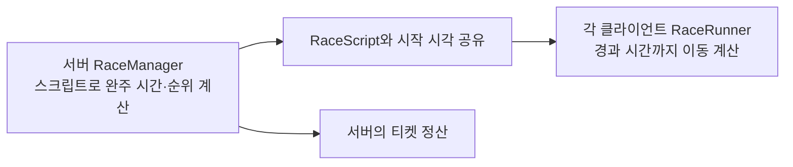
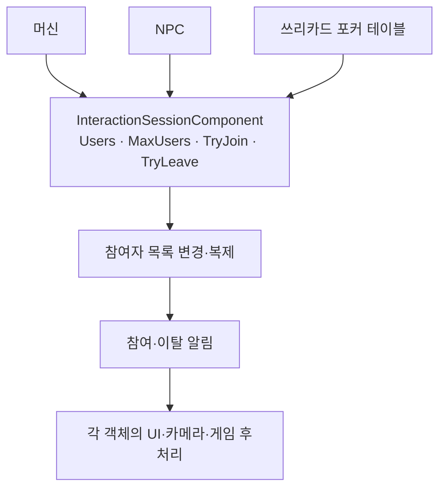
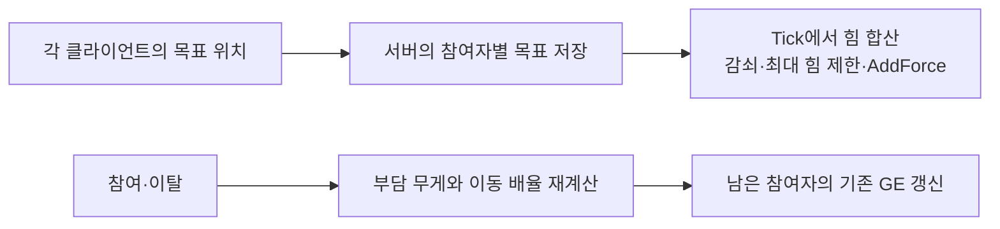

# 김찬울 담당 구현 · 핵심 코드 안내

[프로젝트 소개로 돌아가기](../README.md)

대표 구현 세 가지를 **구조 → 코드 읽는 순서 → 설계 이유와 확인한 동작** 순서로 정리했습니다. 아래 함수 발췌는 프로젝트 소스에 있는 구현입니다. 광차 파일에는 수평 운반 힘 계산 구간만 수록했습니다. [파일별 수록 범위](SourceIndex.md)를 참고해 주세요.

<a id="race-replay"></a>

## 1. 경마: 스크립트 공유와 로컬 재생

경마는 서버가 경주 결과를 먼저 계산하고, 각 클라이언트는 같은 경주 스크립트와 서버 시작 시각을 기준으로 주자의 이동을 재생합니다.



### 코드 읽는 순서

| 순서 | 소스 | 확인할 내용 |
| --- | --- | --- |
| 1 | [RaceTypes.h](../Source/casino_simulator/RaceGame/RaceTypes.h) | 위치·속도·각성·넘어짐·시작 시각을 담는 `FRunnerRaceScript` |
| 2 | [RaceManager::StartRace](../Source/casino_simulator/RaceGame/RaceManager.cpp#L274-L313) | 스크립트로 완주 시간을 계산해 순위를 확정하고, 모든 주자에 같은 시작 시각 전달 |
| 3 | [RaceRunner의 복제 설정](../Source/casino_simulator/RaceGame/RaceRunner.cpp#L18-L58) | 위치 복제를 끄고 `RaceScript`와 경주 상태 복제 |
| 4 | [RaceRunner::TickRacing](../Source/casino_simulator/RaceGame/RaceRunner.cpp#L244-L288) | 서버 경과 시간까지 고정 간격으로 계산한 후 로컬 위치 반영 |

### 구현에서 볼 부분

- `Elapsed`는 서버 현재 시각과 `RaceStartServerTime`의 차이입니다. 프레임마다 이동량만 더하는 대신, 경주가 얼마나 진행됐는지를 기준으로 계산합니다.
- `while` 문으로 로컬 시뮬레이션을 해당 경과 시간까지 따라잡습니다. 각성·넘어짐도 스크립트에 정해진 위치를 기준으로 적용합니다.
- 서버의 완주 시간 계산과 주자의 이동 계산에서 같은 고정 간격과 규칙을 사용합니다. 서버는 판정·정산을, 클라이언트는 화면의 이동 표현을 담당합니다.

<details>
<summary>핵심 함수 보기: RaceRunner::TickRacing</summary>

```cpp
void ARaceRunner::TickRacing()
{
	if (!bIsRunning || RaceScript.RaceStartServerTime < 0.0) return;
	const float Elapsed = FMath::Max(0.f, static_cast<float>(GetServerTime() - RaceScript.RaceStartServerTime));
	constexpr float Step = 1.f / 120.f;
    bool bPlayAwakenEffect = false;
	// Match the manager's fixed-step finish simulation, including late replication.
	while (LocalTime + Step <= Elapsed && PosUnits < RaceScript.TrackLength)
	{
		// 각성 (레시피에 이미 정해져 있음 → 서버·클라 동일 지점에서 발동)
		if (RaceScript.bWillAwaken && !bAwakenedLocal && PosUnits >= RaceScript.AwakenAtPos)
		{
			bAwakenedLocal = true;
            if (HasAuthority())
                if (auto* Manager = Cast<ARaceManager>(GetOwner())) Manager->NotifyRunnerAwakened(this);
            // Don't replay old visual bursts when catching up after late replication.
            bPlayAwakenEffect = Elapsed - LocalTime < 0.5f;
		}
		// 장애물 (각성 안 했을 때만)
		if (!bAwakenedLocal && RaceScript.bWillStumble && !bStumbledLocal && PosUnits >= RaceScript.StumbleAtPos)
		{
			bStumbledLocal = true;
			StumbleUntil = LocalTime + 0.7f;
			OnStumbleFX();
		}

		float Mult = bAwakenedLocal ? 2.3f : 1.f;
		if (LocalTime < StumbleUntil) Mult *= 0.3f;

		PosUnits += RaceScript.Speed * Mult * Step;
		LocalTime += Step;
	}
	if (PosUnits >= RaceScript.TrackLength)
	{
		PosUnits = RaceScript.TrackLength;
		bIsRunning = false;
	}

	SetActorLocation(RaceScript.StartLoc + RaceScript.Dir * PosUnits);
    if (bPlayAwakenEffect)
    {
        PlayAwakenEffect();
        OnAwakenFX();
    }
}
```

</details>

### 설계 이유와 확인한 동작

초기 위치 복제에서는 달리는 주자가 끊겨 보였습니다. 경주 스크립트를 공유하고 각 클라이언트에서 재생하는 방식으로 바꾼 뒤 움직임이 자연스러워졌으며, 클라이언트 간 결승선 통과 순서도 확인했습니다.

<a id="interaction-session"></a>

## 2. 상호작용: 컴포넌트가 관리하는 세션 수명

머신은 `Actor`, NPC는 `Character`를 상속합니다. 두 계층에 공통 부모를 추가하는 대신, 각각 부착할 수 있는 `InteractionSessionComponent`로 참여자 관리와 진입·퇴장 규칙을 통합했습니다.



이 절에서 보여주는 구현은 `InteractionSessionComponent`입니다. 구조도의 머신·NPC·테이블은 컴포넌트를 호출하고 참여·이탈 알림을 받는 연동 객체를 나타냅니다. 각 객체가 세션 컴포넌트를 소유하는 구성입니다.

### 코드 읽는 순서

| 순서 | 소스 | 확인할 내용 |
| --- | --- | --- |
| 1 | [InteractionSessionComponent.h](../Source/casino_simulator/Interaction/InteractionSessionComponent.h) | `Users`, `MaxUsers`, 공개 API와 참여·이탈 delegate |
| 2 | [TryJoin / TryLeave](../Source/casino_simulator/Interaction/InteractionSessionComponent.cpp#L58-L91) | 서버 권위, 사용자 유효성, 정원·중복 참여 검사와 요청 사용자 제거 |
| 3 | [OnRep_Users / RefreshNotifications](../Source/casino_simulator/Interaction/InteractionSessionComponent.cpp#L106-L141) | 이전에 알린 목록과 현재 목록을 비교해 참여·이탈 알림 발생 |

### 구현에서 볼 부분

- `MaxUsers`로 단독 이용과 동시 이용을 구분합니다. `1`은 단독, 양수는 정원, `0`은 인원 제한 없음입니다.
- 서버에서는 목록 변경 직후 `RefreshNotifications()`를 호출하고, 클라이언트에서는 `OnRep_Users()`를 통해 같은 변경 알림 처리를 수행합니다.
- `TryLeave`는 요청한 사용자 한 명만 제거합니다. NPC에서 한 사용자가 나가도 다른 이용자의 세션은 유지됩니다.
- 배당·승패·대화 같은 고유 규칙과 UI·카메라 처리는 각 객체에 남겨두고, 공통 참여·퇴장 규칙을 세션에 모았습니다.

<details>
<summary>핵심 함수 보기: RefreshNotifications</summary>

```cpp
void UInteractionSessionComponent::RefreshNotifications()
{
	for (const TWeakObjectPtr<Acasino_simulatorCharacter>& PreviousUser : NotifiedUsers)
	{
		Acasino_simulatorCharacter* PreviousUserPtr = PreviousUser.Get();
		if (PreviousUserPtr && !ContainsUser(PreviousUserPtr))
		{
			OnUserLeft.Broadcast(PreviousUserPtr);
		}
	}

	for (Acasino_simulatorCharacter* User : Users)
	{
		const bool bWasAlreadyNotified = NotifiedUsers.ContainsByPredicate(
			[User](const TWeakObjectPtr<Acasino_simulatorCharacter>& PreviousUser)
			{
				return PreviousUser.Get() == User;
			});

		if (User && !bWasAlreadyNotified)
		{
			OnUserJoined.Broadcast(User);
		}
	}

	NotifiedUsers.Reset(Users.Num());
	for (Acasino_simulatorCharacter* User : Users)
	{
		NotifiedUsers.Add(User);
	}
}
```

</details>

### 설계 이유와 확인한 동작

기존에는 상호작용의 진입·퇴장과 정리 경로를 여러 클래스에서 따라가야 했습니다. 공통 수명 관리를 한곳에 모으고 중복된 수용 가능 검사를 정리했습니다. 머신의 진입·퇴장·재진입과, NPC 동시 이용 중 한 명만 나가는 동작을 확인했습니다.

<a id="cooperative-carry"></a>

## 3. 협동 운반: 힘 합산과 기존 GE 갱신

단일 운반자를 여러 운반자로 확장했습니다. 각 클라이언트가 자신의 목표 위치를 전달하면, 서버는 참여자별 목표를 저장하고 힘을 합산해 광물을 움직입니다.



### 코드 읽는 순서

| 순서 | 소스 | 확인할 내용 |
| --- | --- | --- |
| 1 | [OrePickupBase.h](../Source/casino_simulator/Mining/OrePickupBase.h) | 참여자 목록, 참여자별 목표 위치와 GE 핸들 |
| 2 | [TryPickUp](../Source/casino_simulator/Mining/OrePickupBase.cpp#L81-L139) | 참여자 추가, 해당 사용자의 GE 적용과 핸들 저장, 전체 이동 효과 갱신 |
| 3 | [GetCarryMovementMultiplier](../Source/casino_simulator/Mining/OrePickupBase.cpp#L47-L53) | 무게와 현재 참여 인원으로 이동 배율 계산 |
| 4 | [RefreshCarryMovementEffects](../Source/casino_simulator/Mining/OrePickupBase.cpp#L149-L177) | 남은 참여자 모두의 기존 GE에 SetByCaller 값 반영 |
| 5 | [TryDrop](../Source/casino_simulator/Mining/OrePickupBase.cpp#L180-L216) | 이탈자의 효과·핸들 제거 후 남은 참여자의 효과 갱신 |
| 6 | [UpdateCarryTargetLocation](../Source/casino_simulator/Mining/OrePickupBase.cpp#L241-L268) · [Tick](../Source/casino_simulator/Mining/OrePickupBase.cpp#L270-L308) | 목표 수신 검증·저장과 서버의 힘 합산 |

### 구현에서 볼 부분

- 참여 인원이 바뀌면 새로 참여하거나 나간 사용자뿐 아니라, 계속 운반 중인 사용자들의 부담도 달라집니다.
- 참여자의 GE 핸들을 저장해 사용합니다. 참여 시 새 효과와 핸들을 추가하고, 이탈 시 해당 효과와 핸들을 제거합니다.
- 남아 있는 사용자의 효과는 제거·재적용하지 않고 `UpdateActiveGameplayEffectSetByCallerMagnitude()`로 값을 바꿉니다.
- `TryPickUp`과 `TryDrop`에서 같은 갱신 함수를 호출하므로, 인원 변화에 따른 계산을 한곳에서 관리합니다.

<details>
<summary>핵심 함수 보기: RefreshCarryMovementEffects</summary>

```cpp
void AOrePickupBase::RefreshCarryMovementEffects()
{

	const float Multiplier = GetCarryMovementMultiplier();

	const FGameplayTag DataTag = FGameplayTag::RequestGameplayTag(FName(TEXT("Data.Ore.CarryMovementMultiplier")));

	for (const auto& Carrier : Carriers)
	{
		if (!IsValid(Carrier.Get()))
		{
			continue;
		}

		UAbilitySystemComponent* ASC = Carrier->GetAbilitySystemComponent();
		const FActiveGameplayEffectHandle* Handle =
			CarryEffectHandles.Find(Carrier.Get());

		if (!ASC || !Handle || !Handle->IsValid())
		{
			continue;
		}

		ASC->UpdateActiveGameplayEffectSetByCallerMagnitude(
			*Handle, DataTag, Multiplier);
	}


}
```

</details>

### 설계 이유와 확인한 동작

처음에는 참여 인원이 달라져도 기존 운반자의 이동 효과가 갱신되지 않았습니다. 참여와 이탈 양쪽에서 갱신 함수를 호출하도록 모으고, 효과를 초기화·재적용하던 흐름을 저장된 핸들의 값 갱신으로 바꿨습니다. 1명 → 2명 → 1명으로 인원이 바뀔 때 남은 사용자의 이동 효과가 갱신되고, 이탈자의 효과가 해제되는 것을 확인했습니다.

## 추가 구현 소스

| 구현 | 먼저 볼 코드 | 확인할 내용 |
| --- | --- | --- |
| 사다리머신 | [ServerStartPlay / ServerReveal](../Source/casino_simulator/UI/LadderMachine.cpp#L374-L430) | 결과·경로 사전 계산, 연출 시작 알림, 서버 타이머 후 정산 |
| 경마 티켓 | [ServerBuyTicket / SettleTickets / ServerClaimWinnings](../Source/casino_simulator/RaceGame/RaceManager.cpp#L550-L629) | 구매 시 정보 보관, 낙첨 삭제·당첨 유지, 소유 티켓 일괄 환전 |
| 채광 TargetData | [클라이언트 타격 데이터 생성](../Source/casino_simulator/Mining/AbilityTask_MiningTargetData.cpp#L79-L126) · [서버 검증](../Source/casino_simulator/Mining/AbilityTask_MiningTargetData.cpp#L38-L69) | 실제 1인칭 카메라 기준 trace, 대상 타입·거리 검증 |
| 광차 운반 | [수평 운반 힘 계산](../Source/casino_simulator/Mining/CartBase.cpp#L5-L15) | 목표 변위·속도의 Z 성분을 제외하고 끄는 힘 계산 |
| 설정 UI | [GetGraphicsMenuSettings / ApplyGraphicsMenuSettings](../Source/casino_simulator/UI/CasinoSettingsSubsystem.cpp#L112-L186) | UI 선택 인덱스와 실제 설정값 변환 |
