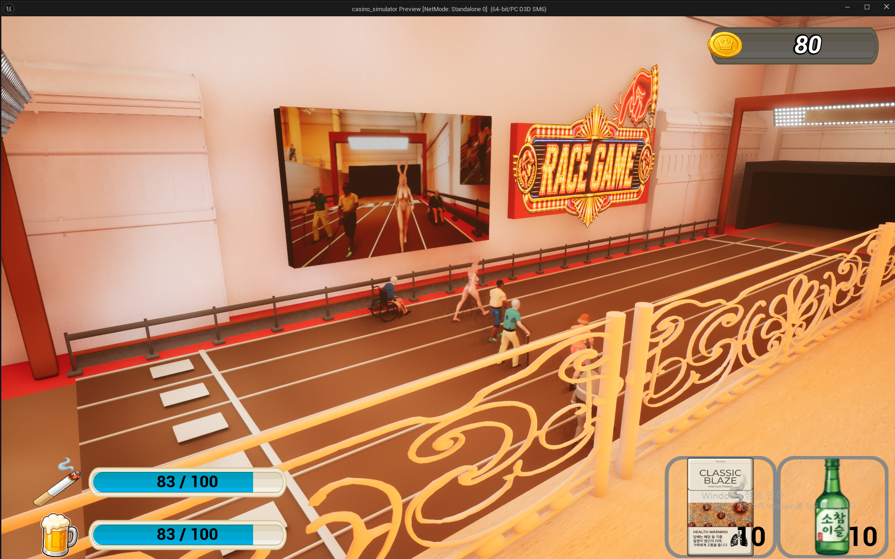
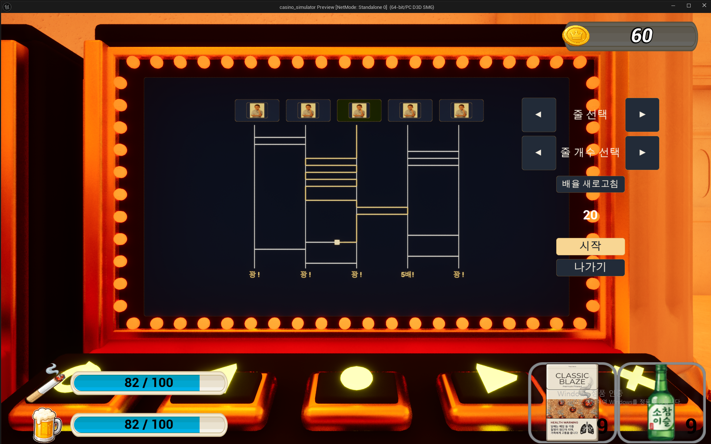

# Casino Simulator · 김찬울 포트폴리오

Unreal Engine 5.7로 제작한 멀티플레이 카지노 게임입니다. 4명이 2개월 동안 개발한 팀 프로젝트이며, 이 README는 **김찬울의 담당 구현과 관련 소스**를 안내합니다.

| 항목 | 내용 |
| --- | --- |
| 개발 환경 | Unreal Engine 5.7 |
| 사용 기술 | C++, Blueprint, Gameplay Ability System(GAS), Unreal Replication |
| 팀 구성 / 기간 | 4명 / 2개월 |
| 구현 방향 | C++로 게임 규칙과 상태를 관리하고 Blueprint로 화면과 연출 연결 |

이 저장소는 **담당 구현을 검토하기 위한 소스 모음**입니다. 전체 실행 프로젝트가 아니며, 광차 파일은 수평 운반 힘 계산 부분만 발췌했습니다. 팀 공통 의존 클래스와 Blueprint·게임 에셋을 포함하지 않아 단독 빌드는 지원하지 않습니다. 파일별 수록 범위는 [소스 구성](Docs/SourceIndex.md)에서 확인할 수 있습니다.

## 구현 시연 영상

[▶ 전체 시연 영상](https://www.youtube.com/watch?v=fHodD7kIsp4)

간략한 게임 소개에 이어 담당 기능의 플레이와 주요 구현 동작을 담았습니다.

| 기능 | 플레이 시연 | 주요 구현 동작 |
| --- | --- | --- |
| 경마 | [00:26 베팅·경주·당첨금 환전](https://www.youtube.com/watch?v=fHodD7kIsp4&t=26s) | [03:03 이동·완주 순서 비교](https://www.youtube.com/watch?v=fHodD7kIsp4&t=183s) |
| 사다리머신 | [01:25 사다리 게임](https://www.youtube.com/watch?v=fHodD7kIsp4&t=85s) | [03:30 공용 화면과 개인 조작 UI 분리](https://www.youtube.com/watch?v=fHodD7kIsp4&t=210s) |
| 공통 상호작용 | — | [02:50 이용자별 세션 유지](https://www.youtube.com/watch?v=fHodD7kIsp4&t=170s) |
| 채광·협동 운반 | [01:55 채광·광물 운반](https://www.youtube.com/watch?v=fHodD7kIsp4&t=115s) | [03:56 참여·이탈에 따른 이동 속도 갱신](https://www.youtube.com/watch?v=fHodD7kIsp4&t=236s) |
| 광차 | [02:26 광차 운반](https://www.youtube.com/watch?v=fHodD7kIsp4&t=146s) | — |

## 대표 코드

아래 세 구현을 먼저 보면 네트워크 연출, 공통 기능 설계, 협동 플레이 처리 방식을 확인할 수 있습니다.

| 구현 | 핵심 설계 | 코드 읽기 |
| --- | --- | --- |
| 경마 로컬 재생 | 서버가 확정한 경주 스크립트와 시작 시각을 공유하고, 각 클라이언트가 이동 재생 | [설계와 소스 흐름](Docs/PortfolioCodeGuide.md#race-replay) · [TickRacing](Source/casino_simulator/RaceGame/RaceRunner.cpp#L244-L288) |
| 상호작용 세션 통합 | 머신·NPC·쓰리카드 포커의 참여자 관리와 진입·퇴장을 공통 컴포넌트로 통합 | [설계와 소스 흐름](Docs/PortfolioCodeGuide.md#interaction-session) · [InteractionSessionComponent](Source/casino_simulator/Interaction/InteractionSessionComponent.cpp) |
| 협동 운반과 이동 효과 | 참여자별 목표 힘을 합산하고, 인원 변경 시 기존 GE의 SetByCaller 값 갱신 | [설계와 소스 흐름](Docs/PortfolioCodeGuide.md#cooperative-carry) · [이동 효과 갱신](Source/casino_simulator/Mining/OrePickupBase.cpp#L149-L177) |

## 담당 구현

| 기능 | 구현 내용 | 관련 소스 |
| --- | --- | --- |
| 경마 | 라운드 진행, 주자 스크립트와 이동, 각성·넘어짐, 전광판, 배당 조정, 티켓 구매·정산·환전 | [RaceManager](Source/casino_simulator/RaceGame/RaceManager.cpp), [RaceRunner](Source/casino_simulator/RaceGame/RaceRunner.cpp) |
| 사다리머신 | 경로·결과 사전 계산, 연출 후 정산, 공용 머신 화면과 사용자 조작 UI 분리, 기존 UI Manager 연동 | [LadderMachine](Source/casino_simulator/UI/LadderMachine.cpp), [LadderWidget](Source/casino_simulator/UI/LadderWidget.cpp) |
| 상호작용 통합 | 서로 다른 상속 구조의 객체에 사용할 세션 컴포넌트 구현, 정원과 동시 이용 관리, 참여·이탈 알림 제공 | [InteractionSessionComponent.h](Source/casino_simulator/Interaction/InteractionSessionComponent.h), [InteractionSessionComponent.cpp](Source/casino_simulator/Interaction/InteractionSessionComponent.cpp) |
| 채광 | 실제 1인칭 카메라 기준 타격 대상 생성, GAS TargetData 전송, 서버의 광석 타입·거리 검증 | [AbilityTask_MiningTargetData](Source/casino_simulator/Mining/AbilityTask_MiningTargetData.cpp) |
| 협동 운반·광차 | 다인 운반의 목표·힘 합산, 참여·이탈 시 이동 효과 갱신, 광차의 수평 운반 힘 계산 | [OrePickupBase](Source/casino_simulator/Mining/OrePickupBase.cpp), [광차 수평 힘 계산](Source/casino_simulator/Mining/CartBase.cpp#L5-L15) |
| 설정 UI | 그래픽 선택 인덱스와 실제 값 변환, 해상도 목록, 사운드·마우스 설정과 저장 | [CasinoSettingsSubsystem](Source/casino_simulator/UI/CasinoSettingsSubsystem.cpp) |

## 인게임 화면

### 경마

주자의 경주를 관전하고, 전광판에서 현재 상황을 확인할 수 있습니다.

### 사다리머신

머신의 게임 화면과 상호작용 사용자의 조작 UI를 분리했습니다.

## 코드 읽는 순서

1. **경마:** [결과 확정](Source/casino_simulator/RaceGame/RaceManager.cpp#L274-L313) → [스크립트 복제](Source/casino_simulator/RaceGame/RaceRunner.cpp#L48-L58) → [로컬 재생](Source/casino_simulator/RaceGame/RaceRunner.cpp#L244-L288)
2. **상호작용:** [컴포넌트의 공개 API와 상태](Source/casino_simulator/Interaction/InteractionSessionComponent.h) → [참여·퇴장](Source/casino_simulator/Interaction/InteractionSessionComponent.cpp#L58-L91) → [복제 후 참여·이탈 알림](Source/casino_simulator/Interaction/InteractionSessionComponent.cpp#L106-L141)
3. **협동 운반:** [참여 시 효과 적용](Source/casino_simulator/Mining/OrePickupBase.cpp#L81-L139) → [기존 효과 갱신](Source/casino_simulator/Mining/OrePickupBase.cpp#L149-L177) → [이탈 시 핸들 제거와 재계산](Source/casino_simulator/Mining/OrePickupBase.cpp#L180-L216)

각 코드의 역할과 선택 이유는 [핵심 코드 안내](Docs/PortfolioCodeGuide.md)에 정리했습니다.
